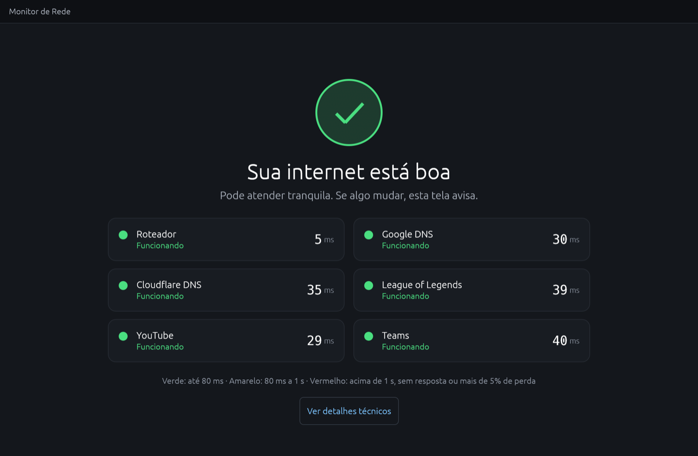
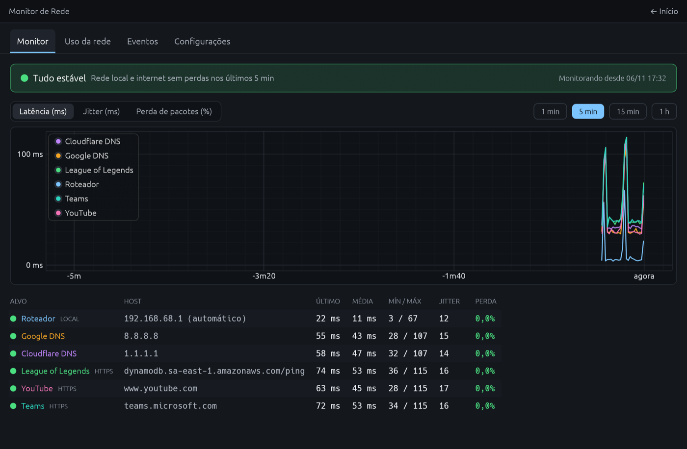
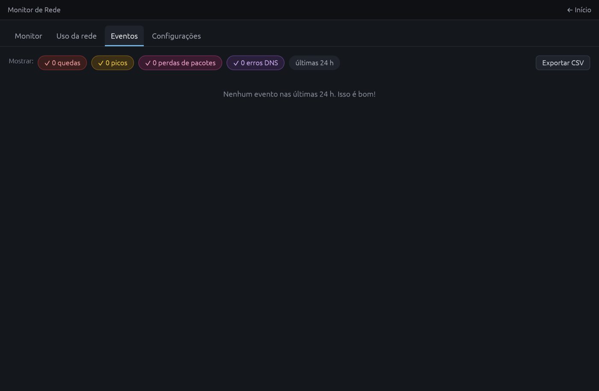
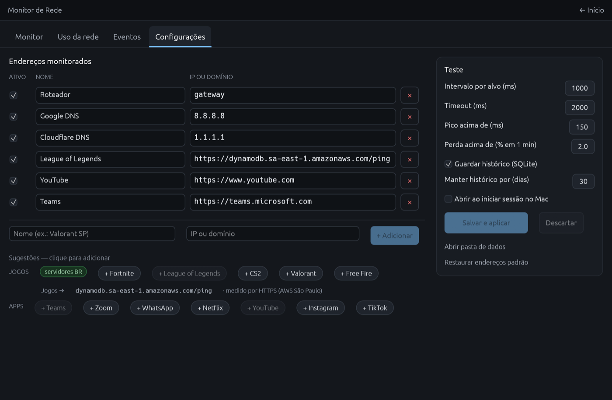
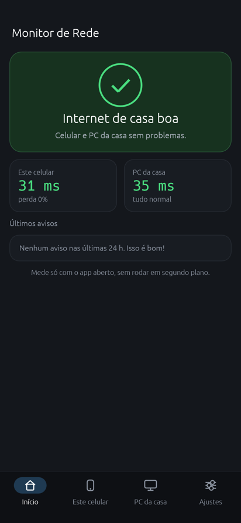
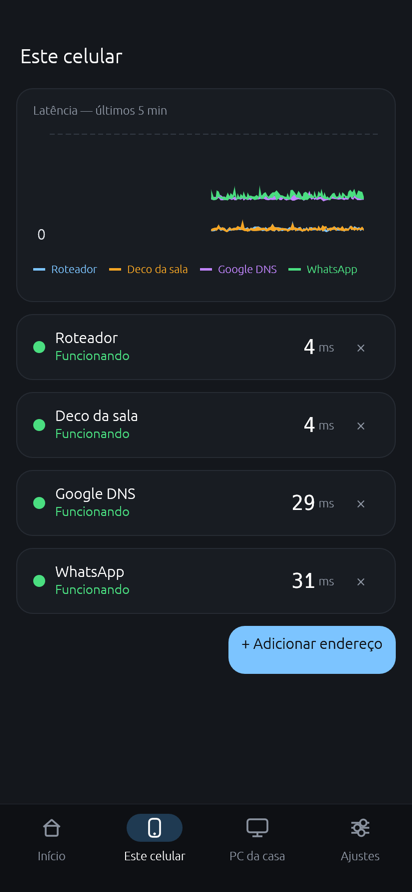
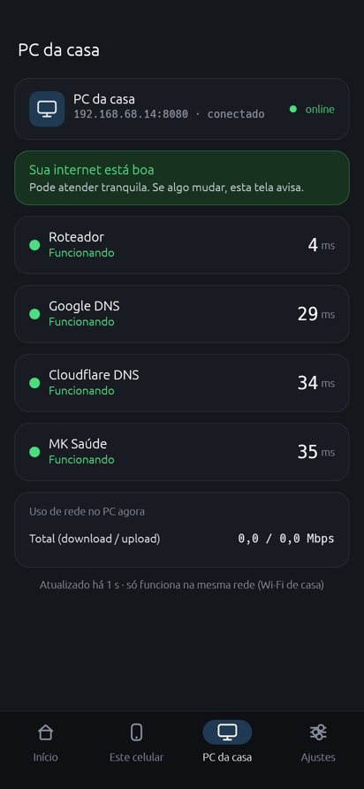
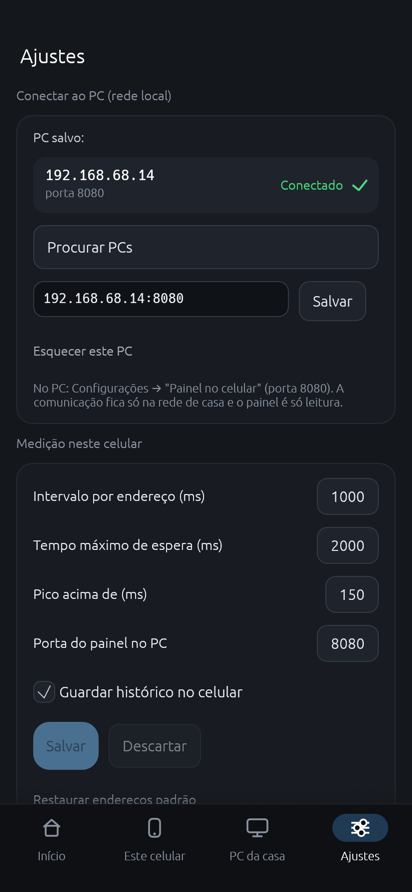

# Monitor de Rede

App de desktop (Windows, macOS e Linux), com uma versão simplificada para Android, que mede continuamente a latência, o jitter e a perda de pacotes até vários endereços, e mostra em linguagem simples se a internet está boa para chamadas de vídeo e jogos.



## Download

Baixe a versão mais recente em **[Releases](https://github.com/hfabio/monitor-de-rede/releases/latest)**:

| Sistema | Arquivo |
|---|---|
| Windows 10/11 (64 bits) | `MonitorRede-windows-x64.exe` |
| macOS (Apple Silicon e Intel) | `MonitorRede-macos-universal.zip` |
| Linux (x64) | `MonitorRede-linux-x64.tar.gz` |
| Android 8 ou mais novo (64 bits) | `MonitorRede-android-arm64.apk` |

No computador, não precisa instalar nada. No Android, veja [Android](#android).

- **Windows:** se o SmartScreen avisar "aplicativo não reconhecido", clique em **Mais informações → Executar assim mesmo**. O executável não é assinado digitalmente.
- **macOS:** descompacte, mova para Aplicativos e, na primeira vez, clique com o botão direito → **Abrir**. Isso é preciso porque o app não é assinado pela Apple.
- **Linux:** descompacte e rode `./monitor-rede`.

## Bandeja do sistema

No Windows e no macOS, **fechar a janela não encerra o app**: ele vai para a bandeja do sistema (perto do relógio) e continua monitorando.

- **Cor do ícone:** acompanha a rede (verde, amarelo ou vermelho). Passe o mouse para ver o resumo.
- **Clique no ícone** (ou **Abrir Monitor de Rede**): mostra a janela de novo.
- **Botão direito → Encerrar app:** fecha de verdade.
- **Iniciar com o sistema:** com essa opção ligada, o app abre direto na bandeja, sem mostrar a janela (argumento `--bandeja`).

No Linux, a bandeja exigiria GTK. Lá, fechar a janela encerra o app.

## Telas

**Início:** mostra o status geral em português do dia a dia e um cartão por endereço, com a latência.
- **Verde:** até 80 ms.
- **Amarelo:** de 80 ms a 1 s.
- **Vermelho:** acima de 1 s, sem resposta ou mais de 5% de perda.

**Monitor:** um diagnóstico automático que separa problema na rede de casa de problema na operadora. Tem gráficos de latência, jitter e perda (janelas de 1 min, 5 min, 15 min e 1 h) e uma tabela com último valor, média, mínimo/máximo, jitter e perda.



**Uso da rede:** mostra a banda total de download e upload e o gráfico dos últimos 5 minutos.
- No Windows, também mostra a banda e as conexões de cada aplicativo.
- A banda por aplicativo exige abrir o app como administrador. Sem isso, aparecem só as conexões, e há um botão para reabrir como administrador.
- Abas do Chrome aparecem juntas numa linha só.
- Tráfego UDP entra só no total.

**Eventos:** registra quedas (3 ou mais medições seguidas sem resposta), retornos, picos de latência, perda de pacotes acima do limite em 1 minuto e erros de DNS. Os filtros mostram a quantidade de cada tipo nas últimas 24 h, e dá para exportar em CSV.



**Configurações:** dá para adicionar, renomear, desativar e remover endereços.
- Há sugestões prontas de jogos (servidores BR) e de apps (Teams, Zoom, WhatsApp, Netflix, YouTube, Instagram e TikTok).
- Também se ajustam o intervalo, o timeout, o limite de pico e o limite de perda.
- O histórico fica em SQLite, com retenção configurável em dias.
- Tem a opção de iniciar junto com o sistema.



### Formatos de endereço

| Exemplo | Como é medido |
|---|---|
| `8.8.8.8`, `google.com` | ping (ICMP) |
| `gateway` | ping no roteador padrão, detectado automaticamente |
| `https://site.com/caminho` | tempo de conexão TCP na porta 443, para servidores que bloqueiam ping |
| `http://site.com`, `1.2.3.4:27015` | tempo de conexão TCP na porta indicada |

As sugestões de jogos usam `https://dynamodb.sa-east-1.amazonaws.com/ping` (AWS São Paulo). Esse endereço dá uma boa aproximação da latência até os servidores brasileiros.

## Painel no celular

Com o app aberto no PC, dá para acompanhar a rede pelo navegador do celular (Android ou iPhone), no mesmo Wi-Fi. A página mostra o status geral, um cartão por endereço com a latência dos últimos minutos, a banda atual e os últimos eventos, e se atualiza a cada 2 segundos.

- A aba **Configurações** mostra o endereço para abrir no celular, como `http://192.168.68.11:8080`, com um botão para copiar.
- Dá para desligar o painel ou trocar a porta (padrão 8080) no cartão **Painel no celular**.
- É só leitura: pelo celular não dá para mudar a configuração nem rodar testes.
- **Windows:** na primeira vez, o Firewall pode pedir permissão. Clique em **Permitir acesso** para redes privadas.
- Se a página mostrar "Sem conexão com o PC", confira se o app está aberto e se o celular está no mesmo Wi-Fi.

## Android

O APK é uma versão simplificada, boa para andar pela casa com o celular e ver onde o Wi-Fi fica lento (por exemplo, perto de cada Deco).

**Instalar:** baixe o `MonitorRede-android-arm64.apk` no celular e abra o arquivo. O Android vai pedir para **permitir instalar apps desconhecidos** para o navegador ou o gerenciador de arquivos. Permita e toque em **Instalar**. O app não está na Play Store.

| Início | Este celular | PC da casa | Ajustes |
|---|---|---|---|
|  |  |  |  |

- **Mede só com o app aberto.** Não roda em segundo plano nem manda notificações. Ao sair (botão Voltar na tela inicial), as medições param.
- **Início:** veredito da casa (este celular e o PC), dois cartões com a latência de cada um e os últimos avisos dos dois.
- **Este celular:** gráfico dos últimos 5 minutos e um cartão por endereço, com as mesmas cores do desktop. O botão **+ Adicionar endereço** abre um formulário com sugestões; o **×** remove.
- **PC da casa:** mostra o que o app do PC está vendo, lido do [Painel no celular](#painel-no-celular) a cada 2 segundos: status, endereços e uso de rede do PC. Só funciona no mesmo Wi-Fi.
- **Ajustes:** **Procurar PCs** acha os PCs com o painel ligado nesta rede (ou digite o IP). Também ajusta o intervalo, o tempo de espera e a porta do painel.
- O **Roteador** é detectado pelo Android. Se não der, numa rede de Deco é usado `192.168.68.1`.

Não tem no Android: uso da rede por aplicativo, banda total, iniciar com o sistema, bandeja, MCP e exportar CSV. O APK é assinado com uma chave de teste. Se uma versão nova não instalar por cima da antiga, desinstale a antiga antes.

## Integração com IA (MCP)

O app também funciona como servidor [MCP](https://modelcontextprotocol.io). Assim, assistentes como Claude, Codex, Antigravity e Cursor podem consultar a rede, e você pode perguntar coisas como "minha internet caiu hoje de manhã?" ou "o servidor do jogo está com perda agora?".

Basta rodar o executável com o argumento `mcp`, que inicia o servidor por stdio, sem janela. A aba **Configurações** mostra os trechos prontos, com o caminho certo do executável, e um botão para copiar.

**Claude Code**

```bash
claude mcp add monitor-rede -- "C:\caminho\MonitorRede-windows-x64.exe" mcp
```

**Claude Desktop, Antigravity, Cursor** (seção `mcpServers` do arquivo de configuração):

```json
{
  "mcpServers": {
    "monitor-rede": { "command": "C:\\caminho\\MonitorRede-windows-x64.exe", "args": ["mcp"] }
  }
}
```

**Codex** (`~/.codex/config.toml`):

```toml
[mcp_servers.monitor-rede]
command = 'C:\caminho\MonitorRede-windows-x64.exe'
args = ["mcp"]
```

No macOS, o comando fica `"/Applications/Monitor de Rede.app/Contents/MacOS/monitor-rede"`.

### Ferramentas

| Ferramenta | O que faz |
|---|---|
| `get_status` | situação atual: veredito em linguagem simples, latência/jitter/perda de cada endereço no último minuto e nos últimos 5 minutos, banda atual, aplicativos que mais usam a rede e eventos recentes |
| `get_events` | quedas, retornos, picos, perdas e erros de DNS de um período, com filtros por tipo e por endereço |
| `get_history` | resumo de um período por endereço (perda, média, melhor e pior latência, jitter), os piores minutos e uma série de até 60 pontos |
| `probe_host` | testa um endereço na hora (ping, `gateway`, `https://…` ou `host:porta`) |
| `list_targets` | endereços e opções configurados |

O status ao vivo vem do app aberto, que grava `status.json` a cada 2 segundos. O histórico, os eventos e o `probe_host` funcionam mesmo com o app fechado.

## Dados

Ficam na pasta de dados do usuário, em `MonitorRede/`:

| Sistema | Pasta |
|---|---|
| Windows | `%APPDATA%\MonitorRede` |
| macOS | `~/Library/Application Support/MonitorRede` |
| Linux | `~/.local/share/MonitorRede` |
| Android | pasta interna do app (é apagada ao desinstalar) |

- **`config.json`:** endereços e opções.
- **`status.json`:** status ao vivo, usado pelo MCP.
- **`celular.json`** (só no Android): o PC da casa escolhido.
- **`historico.sqlite`:** tabela `minutos`, com um resumo por minuto de cada endereço (enviados, perdidos, mínimo/média/máximo, jitter e picos), e tabela `eventos`.

## Compilar

Pré-requisito: Rust estável ([rustup.rs](https://rustup.rs)).

```bash
cargo run --release
```

No Linux, instale antes as dependências gráficas:

```bash
sudo apt-get install libxcb-render0-dev libxcb-shape0-dev libxcb-xfixes0-dev libxkbcommon-dev libssl-dev
```

Para gerar o `.exe` do Windows a partir do macOS:

```bash
brew install rustup mingw-w64
rustup toolchain install stable && rustup target add x86_64-pc-windows-gnu
CARGO_TARGET_X86_64_PC_WINDOWS_GNU_LINKER=x86_64-w64-mingw32-gcc \
  cargo +stable build --release --target x86_64-pc-windows-gnu
```

Para gerar o APK Android (precisa do Android SDK com build-tools, do NDK e de Java):

```bash
rustup target add aarch64-linux-android
ANDROID_HOME=~/Library/Android/sdk ANDROID_NDK_HOME=~/Library/Android/sdk/ndk/<versão> \
  android/build-apk.sh
```

O APK sai em `target/android/MonitorRede-android-arm64.apk`. Não usa Gradle: o script compila a biblioteca com o NDK e monta o pacote com `aapt2`, `zipalign` e `apksigner`. Sem `KEYSTORE` e `KEYSTORE_PASS`, ele cria uma chave de teste.

Para salvar prints de todas as telas e fechar (usado para gerar as imagens deste README):

```bash
MONITOR_REDE_SHOTS=/tmp/prints cargo run
```

## Releases

O workflow [`.github/workflows/build.yml`](.github/workflows/build.yml) compila e testa nos três sistemas e gera o APK Android a cada push. Ao enviar uma tag `v*`, ele também publica os executáveis e o APK numa Release.

Por padrão, cada build assina o APK com uma chave de teste nova. Para manter a mesma chave entre versões (e atualizar sem desinstalar), cadastre os secrets `ANDROID_KEYSTORE_BASE64` (o arquivo `.keystore` em base64) e `ANDROID_KEYSTORE_PASSWORD`.

```bash
git tag v0.3.0 && git push origin v0.3.0
```

## Estrutura

| Arquivo | Conteúdo |
|---|---|
| `src/probe.rs` | ping ICMP (API nativa no Windows e socket ICMP no Android, sem administrador), conexão TCP e detecção do roteador padrão |
| `src/monitor.rs` | uma thread por endereço, com estatísticas e eventos |
| `src/history.rs` | histórico em SQLite |
| `src/netusage.rs` | banda total e banda por aplicativo (Windows) |
| `src/autostart.rs` | iniciar com o sistema |
| `src/assess.rs` | avaliação em linguagem simples (verde, amarelo, vermelho) |
| `src/status.rs` | status ao vivo em JSON |
| `src/mcp.rs` | servidor MCP por stdio |
| `src/tray.rs` | ícone na bandeja do sistema |
| `src/web.rs` | painel no celular: servidor HTTP só leitura e a página (`src/web.html`) |
| `src/ui/` | telas do desktop, feitas com [egui](https://github.com/emilk/egui) |
| `src/lib.rs` | módulos compartilhados entre o desktop (`src/main.rs`) e o Android |
| `src/mobile/` | telas do Android e conexão com o PC da casa (`pc.rs`: leitura do painel e busca na rede) |
| `src/android.rs` | entrada do Android (NativeActivity), pasta de dados, roteador padrão e barras do sistema |
| `android/` | `AndroidManifest.xml`, ícone e `build-apk.sh`, que gera o APK |
